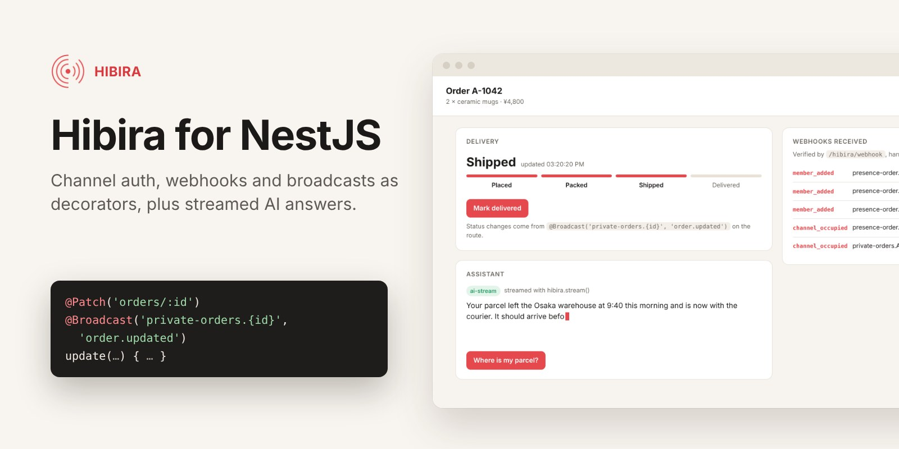
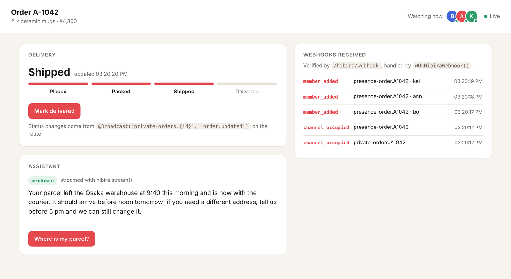
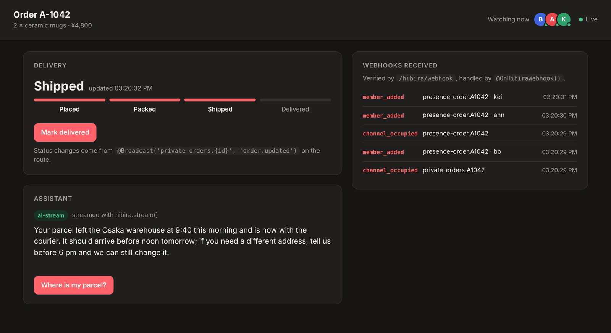
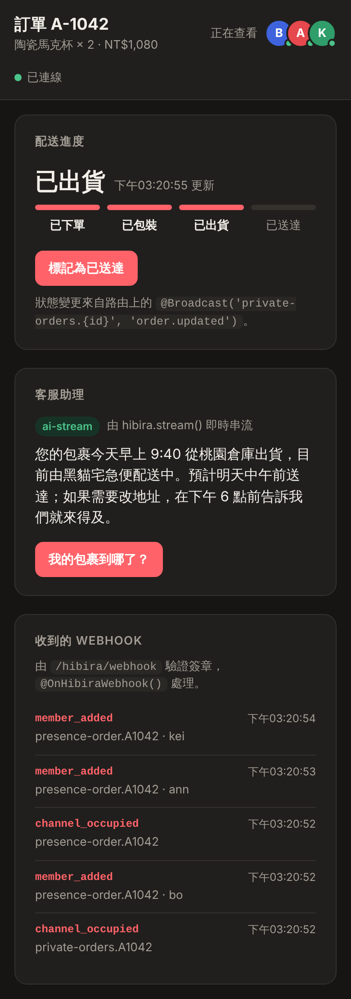

# @hibira-io/nestjs



[](https://www.npmjs.com/package/@hibira-io/nestjs)

[Hibira](https://hibira.io) realtime for [NestJS](https://nestjs.com).
Hibira speaks the Pusher Channels protocol, so pusher-js, Laravel Echo and
the mobile Pusher SDKs connect to it unchanged. This module is the server
side, written the Nest way:

- **`HibiraService`**: publish events, read channels and presence members,
  send to signed-in users, all with signed requests.
- **`@HibiraChannel()`**: authorize private and presence channels with
  decorated provider methods, like Laravel's `routes/channels.php`. The
  module serves the auth route pusher-js and Laravel Echo call.
- **`@OnHibiraWebhook()`**: receive signed webhooks (`member_added`,
  `channel_vacated`, `client_event`...) in any provider.
- **`@Broadcast()`**: publish what a route returns, leaving out the sender.
- **`hibira.stream()`**: stream LLM output to a channel; `useStream()` in
  [@hibira-io/react](https://github.com/hibira-io/react),
  [vue](https://github.com/hibira-io/vue) and
  [nuxt](https://github.com/hibira-io/nuxt) shows it as it is written.
- **`hibira.requestApproval()`**: ask a person to approve before your code
  (or agent) acts, through a Hibira-hosted link.
- **`HibiraPushService`**: push notifications to browsers and phones
  (Beams-compatible).

Works with Nest 10, 11 and 12, on Express or Fastify.



| Dark mode | Phones (Traditional Chinese) |
| --- | --- |
|  |  |

The [example app](example/) is the page above: run it with `npm run example`.

## Install

```sh
npm install @hibira-io/nestjs
```

Create an app at [hibira.io](https://hibira.io) (Free needs no card) and put
its credentials in the environment:

```sh
HIBIRA_APP_ID=...
HIBIRA_KEY=...
HIBIRA_SECRET=...        # server only, never in the browser
HIBIRA_HOST=ws.hibira.io # the host on your app page (default)
```

## Set up

```ts
// app.module.ts
import { Module } from '@nestjs/common';
import { HibiraModule } from '@hibira-io/nestjs';
import { JwtAuthGuard } from './auth/jwt-auth.guard';

@Module({
  imports: [
    HibiraModule.forRoot({
      auth: { guards: [JwtAuthGuard] }, // POST /hibira/auth and /hibira/user-auth
      webhooks: true,                   // POST /hibira/webhook
    }),
  ],
})
export class AppModule {}
```

```ts
// main.ts: webhooks are verified against the exact bytes received
const app = await NestFactory.create(AppModule, { rawBody: true });
```

The module is global, so `HibiraService` can be injected anywhere. With
`@nestjs/config`, use `forRootAsync`:

```ts
HibiraModule.forRootAsync({
  imports: [ConfigModule],
  inject: [ConfigService],
  useFactory: (config: ConfigService) => ({
    appId: config.getOrThrow('HIBIRA_APP_ID'),
    key: config.getOrThrow('HIBIRA_KEY'),
    secret: config.getOrThrow('HIBIRA_SECRET'),
  }),
  auth: { guards: [JwtAuthGuard] }, // routes are set here, not in the factory
  webhooks: true,
});
```

## Publish events

```ts
@Injectable()
export class OrdersService {
  constructor(private readonly hibira: HibiraService) {}

  async ship(order: Order) {
    // ...
    await this.hibira.trigger(`private-orders.${order.id}`, 'order.shipped', { id: order.id });
  }
}
```

| Method | Does |
|---|---|
| `trigger(channels, event, data, { socketId?, info? })` | publish to 1 to 100 channels |
| `triggerBatch([{ channel, name, data }])` | up to 10 events in one request |
| `sendToUser(userId, event, data)` | every connection of a signed-in user |
| `terminateUserConnections(userId)` | disconnect a signed-in user |
| `channels({ prefix?, info? })`, `channel(name, info?)`, `users(name)` | occupied channels, one channel, presence members |
| `clientConfig()` | `key`, `wsHost`, `forceTLS`... safe to send to the browser |
| `pusher` | the underlying [`pusher`](https://github.com/pusher/pusher-http-node) client |

The Free plan allows 4 KB per message; paid plans more.

### `@Broadcast()` a route's result

```ts
@Patch('orders/:id')
@Broadcast('private-orders.{id}', 'order.updated')
update(@Param('id') id: string, @Body() dto: UpdateOrderDto) {
  return this.orders.update(id, dto);
}
```

`{name}` is the route parameter of that name, else the result's field.
The connection named in the `X-Socket-ID` header is left out, so the tab
that made the change does not get it twice (Laravel Echo sends that header
from axios; with pusher-js send `pusher.connection.socket_id` yourself).
Options: `data: ({ result, params, request }) => ...` to shape the event,
`when: (ctx) => boolean`, `toOthers: false`. A channel list or a function
works in place of the name. A failed publish is logged and does not fail
the request.

## Authorize private and presence channels

Turn on `auth` and mark provider methods with `@HibiraChannel(pattern)`:

```ts
@Injectable()
export class Channels {
  constructor(private readonly orders: OrdersService) {}

  @HibiraChannel('private-orders.{orderId}')
  async canSeeOrder(user: User, { orderId }: { orderId: string }) {
    return (await this.orders.find(orderId))?.customerId === user.id;
  }

  // Presence: return the member's user_info (the ID comes from user.id).
  @HibiraChannel('presence-room.{roomId}')
  joinRoom(user: User) {
    return { name: user.name, avatar: user.avatarUrl };
  }
}
```

List the class in some module's `providers`. Return `true` (or, for
presence, a `user_info` object or a full `{ user_id, user_info }`) to let
the user in; anything falsy answers 403. `{name}` matches one
dot-separated part; a `RegExp` works too, with named groups as params. The
third argument has `channel`, `socketId` and the `request`.

The user is `request.user`, set by the guards you list in `auth.guards`.
Visitors without one are refused unless the decorator says
`{ guests: true }`. Change how the user and ID are read with `auth.user`
and `auth.userId` (default `user.id`, then `user.sub`).

In the browser, point the client at the route:

```ts
import Pusher from 'pusher-js';

const pusher = new Pusher('YOUR_APP_KEY', {
  cluster: '',
  wsHost: 'ws.hibira.io',
  forceTLS: true,
  enabledTransports: ['ws', 'wss'],
  channelAuthorization: { endpoint: '/hibira/auth', transport: 'ajax', headers: { Authorization: `Bearer ${token}` } },
  userAuthentication: { endpoint: '/hibira/user-auth', transport: 'ajax', headers: { Authorization: `Bearer ${token}` } },
});
```

With Laravel Echo set `authEndpoint: '/hibira/auth'`, or move the route to
Echo's default with `auth: { path: 'broadcasting/auth' }`. A global prefix
(`app.setGlobalPrefix('api')`) applies to these routes too.

`/hibira/user-auth` signs users in (`pusher.signin()`), which
`sendToUser()` and `terminateUserConnections()` need. Add `user_info` or a
`watchlist` with `auth.userData`, or turn the route off with
`userPath: false`.

## Webhooks

Add `https://your-api.example.com/hibira/webhook` on the app page
(Webhooks), turn on `webhooks`, and handle events in any provider:

```ts
@Injectable()
export class RoomEvents {
  @OnHibiraWebhook('member_added', 'member_removed')
  async presence(event: WebhookEvent) {
    await this.rooms.touch(event.channel, event.user_id);
  }

  @OnHibiraWebhook() // every event
  log(event: WebhookEvent, { timeMs }: { timeMs: number }) {}
}
```

Requests whose `X-Pusher-Key` or `X-Pusher-Signature` do not match are
answered 401. A handler that throws answers 500, and Hibira sends the whole
batch again (for up to 5 minutes), so keep handlers idempotent. During a
secret rotation set `webhooks: { previousSecret }` to also accept the
`X-Hibira-Previous-Signature` header. Without the route, call
`hibira.verifyWebhook(headers, rawBody)` in your own controller.

## Stream LLM output

```ts
@Post('chats/:id/messages')
async ask(@Param('id') id: string, @Body() body: { text: string }) {
  const stream = await this.anthropic.messages.stream({ /* ... */ });
  // Answer the request right away; the text follows on the channel.
  this.hibira.stream(`private-chat.${id}`, stream, { meta: { role: 'assistant' } }).catch((err) => this.logger.error(err));
  return { ok: true };
}
```

`stream()` reads Anthropic, OpenAI (chat and responses), Gemini and Vercel
AI SDK streams, async iterables of strings and `ReadableStream`s. It sends
one event per 100 ms instead of one per token, each under 3,500 bytes, in
order, and a last event with `done: true` (and the whole text when it
fits). It is the same protocol as `streamToChannel` in @hibira-io/react,
vue and nuxt, so their `useStream()` puts the text back together, and with
channel history on (Hobby and up) a reload mid-answer catches up.

## Ask a person for approval

```ts
const request = await this.hibira.requestApproval({
  title: 'Refund order #1042 for $89?',
  details: 'Customer says the parcel never arrived.',
  options: ['Refund', 'Decline'], // the first one approves
  pushInterests: ['ops'],         // or share request.url yourself
});
const answer = await this.hibira.waitForApproval(request.approval_id, { timeoutMs: 10 * 60_000 });
if (answer.status === 'approved') await this.refunds.issue(1042);
```

Statuses are `pending`, `approved`, `rejected` and `expired`;
`getApproval(id, { wait })` reads one without looping. Pass `channel` to
also show the request in the
[@hibira-io/approvals](https://github.com/hibira-io/approvals) inbox.
Approvals work for apps in a Hibira account.

## Push notifications

Turn on Push on the app page, then set `HIBIRA_PUSH_INSTANCE_ID` and
`HIBIRA_PUSH_SECRET_KEY` (or `push: { instanceId, secretKey }`):

```ts
constructor(private readonly push: HibiraPushService) {}

await this.push.publishToUsers([user.id], {
  web: { notification: { title: 'Order shipped', deep_link: 'https://shop.example.com/orders/1042' } },
  fcm: { notification: { title: 'Order shipped' } },
  apns: { aps: { alert: { title: 'Order shipped' } } },
});

// The token endpoint @hibira-io/push-web and the mobile SDKs call, behind your auth:
@Get('push/token')
token(@Req() req) {
  return this.push.generateToken(req.user.id);
}
```

Also `publishToInterests(interests, payload)` and `deleteUser(userId)`.

## Options

| Option | Environment | Default |
|---|---|---|
| `appId`, `key`, `secret` | `HIBIRA_APP_ID`, `HIBIRA_KEY`, `HIBIRA_SECRET` | required |
| `host` | `HIBIRA_HOST` | `ws.hibira.io` |
| `port`, `useTLS` | `HIBIRA_PORT`, `HIBIRA_USE_TLS` | 443, true |
| `timeout` | | 10000 ms |
| `encryptionMasterKeyBase64` | `HIBIRA_ENCRYPTION_MASTER_KEY` | for `private-encrypted-*` channels |
| `push: { instanceId, secretKey, endpoint }` | `HIBIRA_PUSH_INSTANCE_ID`, `HIBIRA_PUSH_SECRET_KEY`, `HIBIRA_PUSH_ENDPOINT` | off |
| `pusher` | | use your own `pusher` instance |
| `auth: { path, userPath, guards, user, userId, userData }` | | off; paths `hibira/auth`, `hibira/user-auth` |
| `webhooks: { path, previousSecret }` | | off; path `hibira/webhook` |
| `isGlobal` | | true |

## Development

```sh
npm test         # unit tests (Express and Fastify)
npm run test:e2e # against a running server, see test/e2e/module.e2e.ts
npm run build
npm run example  # the example app, see example/README.md
```

## License

MIT

## 中文摘要

`@hibira-io/nestjs` 是 Hibira 的 NestJS 模組。`HibiraModule.forRoot()` 從環境變數
（`HIBIRA_APP_ID`、`HIBIRA_KEY`、`HIBIRA_SECRET`）讀取設定，注入 `HibiraService`
即可發送事件。用 `@HibiraChannel()` 裝飾器授權 private / presence 頻道（類似
Laravel 的 `routes/channels.php`），模組會提供 pusher-js 與 Laravel Echo 呼叫的
`/hibira/auth` 路由；`@OnHibiraWebhook()` 接收已驗證簽章的 webhook（需
`rawBody: true`）；`@Broadcast()` 把路由回傳值推送到頻道並排除發送者；
`hibira.stream()` 串流 LLM 輸出，前端用 @hibira-io/react / vue / nuxt 的
`useStream()` 顯示；`requestApproval()` 請人核准；`HibiraPushService` 發送推播。
支援 Nest 10、11、12，Express 與 Fastify。`example/` 有一個可直接執行的即時訂單頁面範例。
