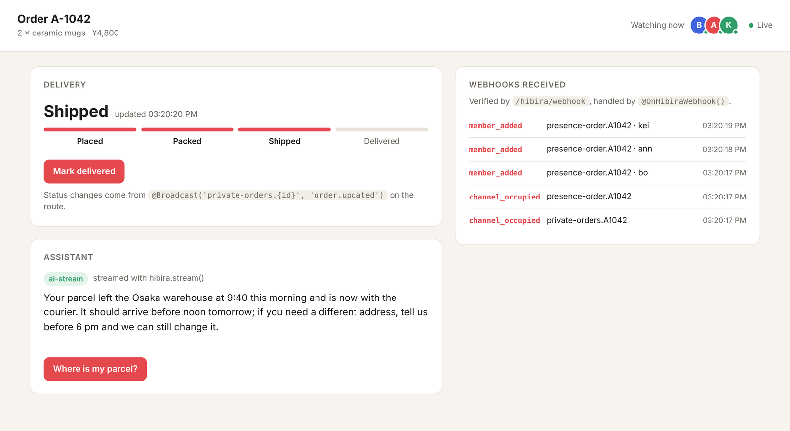

# Example: a live order page

One Nest app ([app.ts](app.ts)) and one HTML page ([public/index.html](public/index.html))
that use every part of `@hibira-io/nestjs`:

- `@HibiraChannel()` authorizes `private-orders.{orderId}`, the
  `presence-order.{orderId}` watchers and the `private-ops` log behind a
  guard (a demo one that reads `X-User`; use your real guard).
- `@Broadcast('private-orders.{id}', 'order.updated')` publishes each status
  change, leaving out the tab that made it.
- `hibira.stream()` streams the assistant's answer token by token.
- `@OnHibiraWebhook()` receives every webhook and shows it on the page.



## Run it

1. Create an app at [hibira.io](https://hibira.io). Under **Webhooks**, add
   your public URL plus `/hibira/webhook` (a tunnel such as `cloudflared` or
   `ngrok` works for a local machine). Without it everything else still works.
2. From the repository root:

   ```sh
   npm install
   HIBIRA_APP_ID=... HIBIRA_KEY=... HIBIRA_SECRET=... npm run example
   ```

3. Open `http://localhost:3999/?user=bo` (support, sees the webhook log), and
   in other windows `?user=ann` and `?user=kei`. Add `&lang=zh-TW` or
   `&theme=dark` if you like. Mark the order shipped in one window and ask
   the assistant in another: every window updates.

`HIBIRA_HOST`, `HIBIRA_PORT` and `HIBIRA_USE_TLS=false` point it at a
self-hosted or local server instead.

## 中文摘要

這個範例是一個即時訂單頁面：用 `@HibiraChannel()` 授權頻道、`@Broadcast()`
推送狀態變更、`hibira.stream()` 串流客服助理的回答、`@OnHibiraWebhook()`
顯示收到的 webhook。設定 `HIBIRA_APP_ID`、`HIBIRA_KEY`、`HIBIRA_SECRET` 後執行
`npm run example`，開啟 `http://localhost:3999/?user=bo`，再用 `?user=ann`、
`?user=kei` 開其他視窗；加上 `&lang=zh-TW` 可看中文介面。
